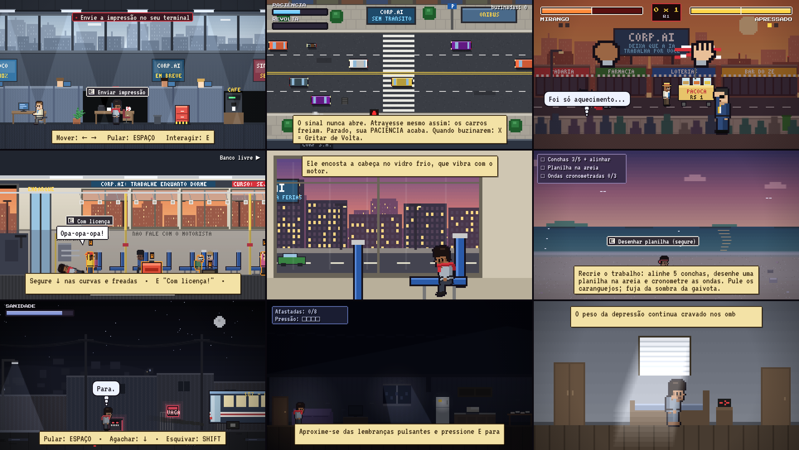

# O Ciclo de Mirango



Jogo de plataforma 2D em pixel art para navegador, baseado no GDD *"O Mundo de Mirango"* e no roteiro expandido do projeto.
Cinco capítulos (Negação → Raiva → Barganha → Depressão → Aceitação), cada um com mudanças de câmera, de gênero e de paleta conforme o estado emocional do protagonista.

## Como jogar

Abra `index.html` em um navegador moderno — não há etapa de build. Para evitar restrições de `file://`, sirva a pasta localmente:

```bash
python3 -m http.server 8000
# depois abra http://localhost:8000
```

| Ação | Teclado | Gamepad | Toque |
|---|---|---|---|
| Mover | ← → / A D | Analógico / D-pad | ◀ ▶ |
| Pular | Espaço / ↑ / W | A | PULO |
| Agachar · segurar | ↓ / S | ↓ | ▼ |
| Interagir · confirmar | E / Z / Enter | X | E |
| Gritar · rejeitar · empurrar | X / Q | B | X |
| Esquivar (cap. 4) | Shift / C | RB | ⇢ |
| Pausa | Esc / P | Start | II |
| Som · tela cheia | M · F | — | — |

Atalho de desenvolvimento: abrir com `#nome_da_cena` (ex.: `index.html#c3_climb`) carrega uma cena diretamente.

## Capítulos e minigames

1. **Negação — o cérebro institucionalizado**: plataforma no escritório; impressões, e-mails a cada 13 s (depois 8 s e 5 s), barras de Energia e Sanidade, o diretor andarilho, a "reunião rápida de alinhamento" com QTE de concordar, e o colapso final: *"EU ME DEMITO!"*.
2. **Raiva — a subversão da matriz centralizada**: `[X] Rejeitar`; *A Faixa do Foda-se* (travessia arcade top-down com Paciência, Revolta e "Gritar de Volta"); *O Duelo da Paçoca* (jogo de luta + jokenpô, melhor de 3 com bullet time); *Tetris Humano* (equilíbrio no ônibus lotado + QTE do assento).
3. **Barganha — o paraíso vazio**: praia paradisíaca sem HUD; a moeda sem valor; *A Colheita do Coco* (plataforma vertical com cipós, galhos quebradiços e macacos); a abstinência ao pôr do sol; *O Construtor de Ilusões* (tédio, meteoros de e-mail, blocos de burocracia, glitch); **PUM!**
4. **Depressão — o labirinto de pensamentos intrusivos**: rua noturna com gatilhos (lixeiras, panfletos, vultos que viram chefes apontando, e-mails e alarmes gigantes); *Sufocado pelo Próprio Teto* (afastar esferas de lembranças antes que as paredes do escritório se fechem).
5. **Aceitação — o ciclo eterno e a falsa promoção**: despertador, a rua cinzenta, o elevador que repete o primeiro quadro do jogo, o escritório automatizado, a "promoção" e o recomeço do ciclo.

## Estrutura técnica

- `js/core.js` — tela 320×180 (escalonada sem suavização), entradas (teclado, toque, gamepad), roteiros com geradores, física de plataforma, herói, partículas e gerenciador de cenas.
- `js/audio.js` — áudio 100% sintetizado em WebAudio: trilha adaptativa (o andamento e o filtro mudam com o estado de Mirango), efeitos e ambiências.
- `js/art.js` — personagens desenhados proceduralmente em pixel art (Mirango: pele negra clara, cachecol vermelho), fonte 3×5 para textos no cenário, objetos.
- `js/ui.js` — balões de quadrinhos (fala, pensamento, grito), legendas, HUD, prompts e pausa.
- `js/title.js`, `js/ch1.js` … `js/ch5.js`, `js/main.js` — tela de título, capítulos e o laço principal com pós-processamento (dessaturação, vinheta, glitch).

Nenhum arquivo de imagem ou som externo é usado; as únicas dependências externas são as fontes *Press Start 2P* e *VT323* do Google Fonts (com fallback monoespaçado).


## Créditos

- Idealização: **@guimirango**
- FATEC SEBRAE — Curso de Marketing (3º semestre) — Sociedade e Cultura, 2026
- Agradecimento especial ao professor Alexander Homenko Neto
- Dedicado a Isabele Ribeiro
